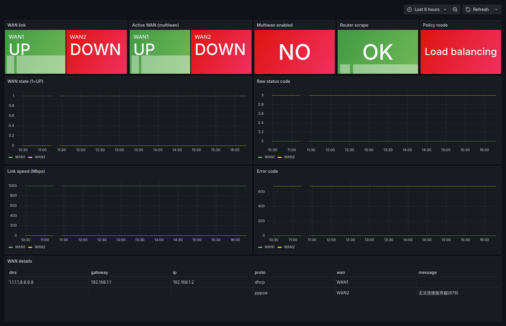
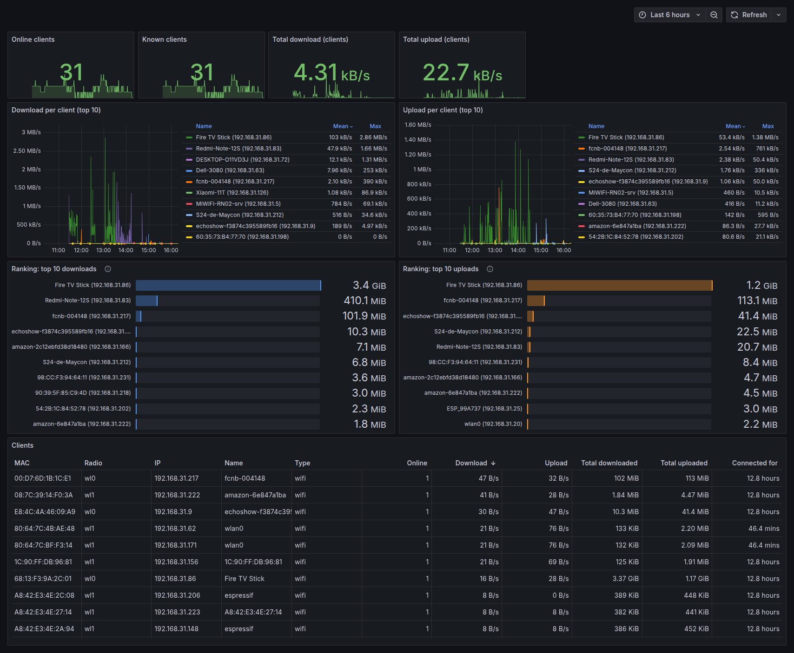

# WAN/LAN Monitor – Xiaomi BE6500

[Português](README.md) | **English**

[](https://github.com/maypimentel/router-xiaomi-be6500-monitor/actions/workflows/tests.yml?query=branch%3Amain)
[](LICENSE)
[](https://www.python.org/downloads/release/python-3140/)

<p align="center">
  
  <br><sub>Image: <a href="https://www.mi.com/xiaomi-routers/be-6500/">Xiaomi</a> (official product page)</sub>
</p>

Monitoring for the Xiaomi BE6500 router with Prometheus and Grafana. A Python exporter logs in to the router's web interface, collects the state of the WANs (multiwan, PPPoE/DHCP, IPv6) and of the LAN clients, and exposes everything in Prometheus format. The stack (exporter + Prometheus + Grafana) runs with Docker Compose and ships with dashboards and alerts.

## Quick start
Requirements: Docker with Compose and access to the router on the local network.

```shell
cp .env.example .env   # fill in ROUTER_PASSWORD
docker compose up -d --build
```

Open Grafana at http://localhost:3000 (default user and password `admin`/`admin`; change `GRAFANA_PASSWORD` before starting). The dashboards are under **Dashboards**.

> Grafana listens on all of the machine's interfaces on port `GRAFANA_PORT`. Prometheus and the exporter are not exposed; only Grafana reaches them, through the Compose internal network.

## Configuration (`.env`)
| Variable | Default | Description |
|---|---|---|
| `ROUTER_PASSWORD` | (required) | Admin password of the router's web interface. It is the same as the Wi-Fi password only if you chose that during initial setup. |
| `ROUTER_HOST` | `192.168.31.1` | Router address. |
| `SCRAPE_INTERVAL` | `15` | Exporter collection interval, in seconds. |
| `RETENTION` | `90d` | How long Prometheus keeps the data. |
| `GRAFANA_USER` / `GRAFANA_PASSWORD` | `admin` / `admin` | Grafana login. |
| `GRAFANA_PORT` | `3000` | Grafana port on the machine. |
| `TELEGRAM_BOT_TOKEN` / `TELEGRAM_CHAT_ID` | (empty) | Telegram alerts; see [Alerts](#alerts). |

After changing `.env`, run `docker compose up -d` to apply it.

## Dashboards
**Xiaomi BE6500 - WANs**: state of each WAN, active WAN in multiwan, policy, link speed, status and error codes, and details (IP, gateway, DNS).



**Xiaomi BE6500 - LAN (clients)**: online clients, download/upload speed per client (top 10), ranking of the 10 largest download and upload volumes, and a table with all clients.



The dashboards are provisioned from `grafana/dashboards/*.json`: changes made in the Grafana UI cannot be saved. To change a panel, edit the JSON (or export the dashboard from Grafana and replace the file); Grafana reloads it automatically.

## Alerts
Rules provisioned in `grafana/provisioning/alerting/`:

| File | Alert | Fires when |
|---|---|---|
| `wan-alerts.yml` | WAN1 down | WAN1 is disconnected for 1 min |
| `wan-alerts.yml` | WAN2 down (multiwan enabled) | WAN2 is disconnected for 1 min while multiwan is enabled |
| `wan-alerts.yml` | Router not responding | The exporter cannot collect for 2 min |
| `lan-alerts.yml` | New device on the network | A MAC not seen in the previous 7 days shows up. Only starts evaluating after ~30 min of collection. |

### Telegram (disabled by default)
Without Telegram, alerts only show up in the Grafana UI (**Alerting**). To receive them on Telegram:

1. Create a bot with `@BotFather` and copy the token.
2. Send a message to the bot (or add it to a group) and get the chat id at `https://api.telegram.org/bot<TOKEN>/getUpdates`.
3. Fill in `TELEGRAM_BOT_TOKEN` and `TELEGRAM_CHAT_ID` in `.env`.
4. Enable the contact point and start the stack again:
   ```shell
   rm grafana/provisioning/alerting/telegram-off.yml
   mv grafana/provisioning/alerting/telegram.yml.disabled grafana/provisioning/alerting/telegram.yml
   docker compose up -d
   ```

## Metrics
Exposed by the exporter on port `9877` (Compose internal network).

| Metric | Labels | Description |
|---|---|---|
| `router_scrape_success` | | 1 if the last collection succeeded |
| `router_scrape_duration_seconds` | | Duration of the last collection |
| `router_multiwan_enabled` | | 1 if multiwan is enabled |
| `router_multiwan_policy_mode` | | 0=load balancing, 1/2=failover, 3=WAN1 only, 4=WAN2 only |
| `router_multiwan_current_wan` | `wan` | 1 for the active WAN |
| `router_multiwan_weight`, `router_multiwan_bandwidth` | `wan` | Configured weight and bandwidth |
| `router_wan_up` | `wan` | 1 if the WAN is connected |
| `router_wan_status_code` | `wan` | 1=dialing, 2=ok, 3=failed, 4=disconnected |
| `router_wan_link_speed_mbps` | `wan` | Negotiated port speed |
| `router_wan_error_code` | `wan` | Error code (e.g. 678 = no PPPoE response) |
| `router_wan_info` | `wan`, `proto`, `ip`, `gateway`, `dns`, `message` | WAN details (value always 1) |
| `router_wan_ipv6_up` | | 1 if IPv6 on the main WAN is up |
| `router_clients_online`, `router_clients_known` | | Online clients and total in the router's list |
| `router_client_download_bytes_per_second`, `router_client_upload_bytes_per_second` | `mac` | Current client speed |
| `router_client_download_bytes`, `router_client_upload_bytes` | `mac` | Volume since the client connected (resets on reconnect) |
| `router_client_online_seconds` | `mac` | Time connected |
| `router_client_info` | `mac`, `name`, `ip`, `type`, `band` | Client name, IP, type and radio (1 if online) |

Per-client metrics are identified by MAC only, so the history is not split when a device is renamed or changes IP. To get the name, join with `router_client_info`:
```promql
router_client_download_bytes * on(mac) group_left(name, ip) router_client_info
```

### Router endpoints used
- `api/misystem/get_ps_service?service=multiwan` – enabled, policy, active WAN, weights
- `api/xqnetwork/get_wan_status` – IPv4/IPv6 of the main WAN
- `api/xqnetwork/pppoe_status?wan_name=WAN1|WAN2` – status/error/speed of each WAN
- `api/xqnetwork/macbind_info` – clients: online, IP, radio, speed and usage

## Updating
```shell
git pull
docker compose up -d --build
```
Prometheus and Grafana data live in Docker volumes and are kept.

## Discovering API endpoints (`tools/discover.py`)
The script logs in to the router, downloads the web interface home page and lists the API URLs (`api/...`) and `.js` files it references. The full page is saved to `home.html` (ignored by git) for manual inspection.

**When to run it**
- After a router firmware update, if the exporter starts failing (`router_scrape_success = 0`) or metrics start coming back as zero: an endpoint may have changed its name or format.
- When you want to collect something new: look for a candidate endpoint in the list and query it to see the JSON. That is how `macbind_info` was found.

**How to run it** (from the repository root):
```shell
pip install -r requirements.txt
ROUTER_PASSWORD='your-password' python tools/discover.py
```
Or in a container, without a local Python, using `ROUTER_PASSWORD` from `.env`:
```shell
docker run --rm --env-file .env -v "$PWD":/app -w /app python:3.14-slim \
  sh -c "pip install -q -r requirements.txt && python tools/discover.py"
```

The output contains the session token (`stok=...`) and so does `home.html`; do not publish either of them. To query an endpoint from the list, use the same token: `curl "http://192.168.31.1/cgi-bin/luci/;stok=<token>/api/<endpoint>"`. The list only covers what the home page references; APIs from other screens may be in the listed `.js` files (`js:` lines).

## Tests
The tests use fictitious router responses (`tests/fixtures/`), with no network access, and run on GitHub Actions for every PR and push to `main`:
```shell
pip install -r requirements.txt -r requirements-dev.txt
python -m pytest
```
Without a local Python, run them in a container:
```shell
docker run --rm -v "$PWD":/app -w /app python:3.14-slim \
  sh -c "pip install -q -r requirements.txt -r requirements-dev.txt && python -m pytest"
```
