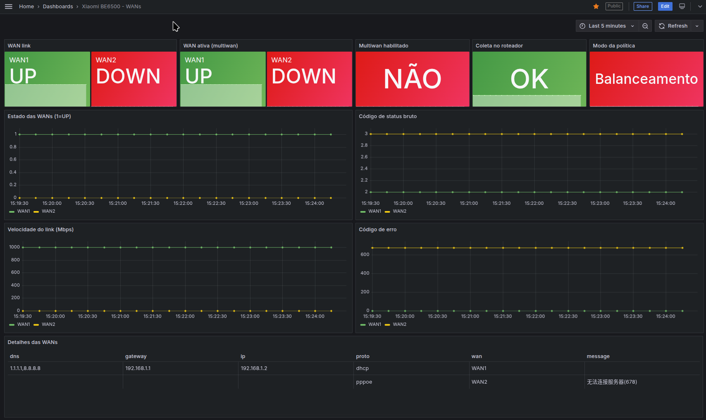
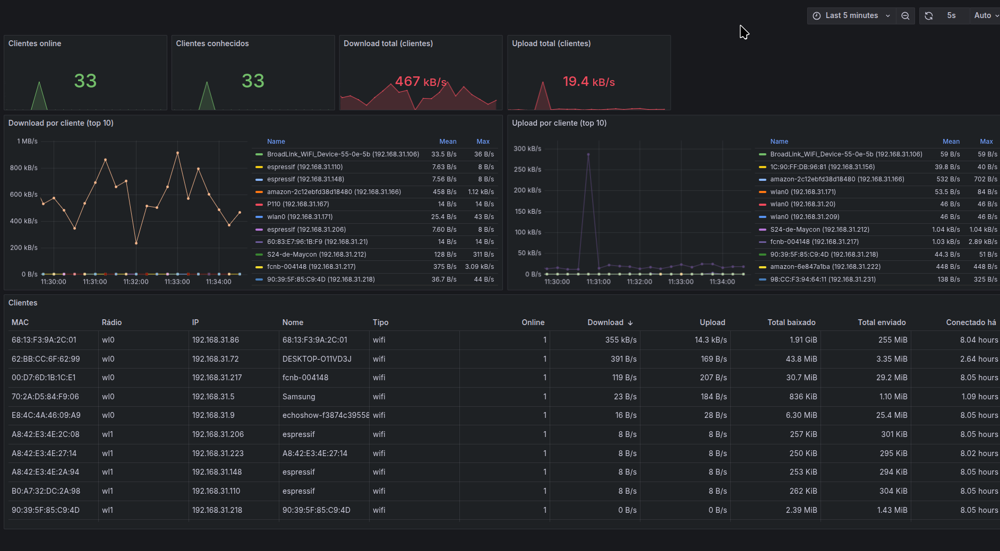

# Monitor WAN/LAN – Xiaomi BE6500

<p align="center">
  
  <br><sub>Imagem: <a href="https://www.mi.com/xiaomi-routers/be-6500/">Xiaomi</a> (página oficial do produto)</sub>
</p>

Exporter Python que faz login na interface web do roteador (`192.168.31.1`), coleta o status do multiwan/WANs e dos clientes da LAN e expõe em formato Prometheus. A stack (exporter + Prometheus + Grafana) sobe via Docker Compose.

## Uso
```
cp .env.example .env   # preencha ROUTER_PASSWORD (senha do WiFi)
docker compose up -d --build
```
Grafana: http://localhost:3000 (admin/admin por padrão) → dashboard "Xiaomi BE6500 - WANs".



Clientes da LAN (velocidade, consumo e tempo conectado) ficam no dashboard "Xiaomi BE6500 - LAN (clientes)":



## Endpoints do roteador usados
- `api/misystem/get_ps_service?service=multiwan` – habilitado, política, WAN ativa, pesos
- `api/xqnetwork/get_wan_status` – IPv4/IPv6 da WAN principal
- `api/xqnetwork/pppoe_status?wan_name=WAN1|WAN2` – status/erro/velocidade de cada WAN
- `api/xqnetwork/macbind_info` – clientes: online, IP, rádio, velocidade e consumo

## Alertas
- WAN (`wan-alerts.yml`): WAN1 caiu, WAN2 caiu (com multiwan ativo), roteador sem resposta.
- LAN (`lan-alerts.yml`): novo dispositivo na rede (MAC não visto nos 7 dias anteriores). Só começa a avaliar após ~30 min de coleta.

## Descobrir endpoints da API (`tools/discover.py`)
O script faz login no roteador, baixa a página inicial da interface web e lista as URLs de API (`api/...`) e os arquivos `.js` que ela referencia. A página completa fica salva em `home.html` (ignorado pelo git) para inspeção manual.

**Quando rodar**
- Depois de atualizar o firmware do roteador, se o exporter começar a falhar (`router_scrape_success = 0`) ou se métricas passarem a vir zeradas: um endpoint pode ter mudado de nome ou de formato.
- Ao querer coletar uma informação nova: procure na lista um endpoint candidato e consulte-o para ver o JSON. Foi assim que `macbind_info` foi encontrado.

**Como rodar** (a partir da raiz do repositório):
```
pip install -r requirements.txt
ROUTER_PASSWORD='sua-senha' python tools/discover.py
```
Ou num container, sem Python local, usando o `ROUTER_PASSWORD` do `.env`:
```
docker run --rm --env-file .env -v "$PWD":/app -w /app python:3.12-slim \
  sh -c "pip install -q -r requirements.txt && python tools/discover.py"
```

A saída contém o token de sessão (`stok=...`) e o `home.html` também; não publique nenhum dos dois. Para consultar um endpoint da lista, use o mesmo token: `curl "http://192.168.31.1/cgi-bin/luci/;stok=<token>/api/<endpoint>"`. A lista cobre só o que a página inicial referencia; APIs de outras telas podem estar nos arquivos `.js` listados (linhas `js:`).

## Alertas no Telegram (atualmente DESATIVADO)
Para ativar: `rm grafana/provisioning/alerting/telegram-off.yml && mv grafana/provisioning/alerting/telegram.yml.disabled grafana/provisioning/alerting/telegram.yml`, depois siga os passos abaixo.

1. Crie um bot com o `@BotFather` e copie o token.
2. Mande uma mensagem ao bot (ou adicione-o ao grupo) e obtenha o chat id em `https://api.telegram.org/bot<TOKEN>/getUpdates`.
3. Preencha `TELEGRAM_BOT_TOKEN` e `TELEGRAM_CHAT_ID` no `.env` e rode `docker compose up -d`.

## Testes
Os testes usam respostas fictícias do roteador (`tests/fixtures/`), sem acesso à rede:
```
pip install -r requirements.txt -r requirements-dev.txt
python -m pytest
```
Sem Python local, rode num container: `docker run --rm -v "$PWD":/app -w /app python:3.12-slim sh -c "pip install -q -r requirements.txt -r requirements-dev.txt && python -m pytest"`.
